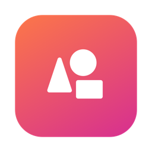
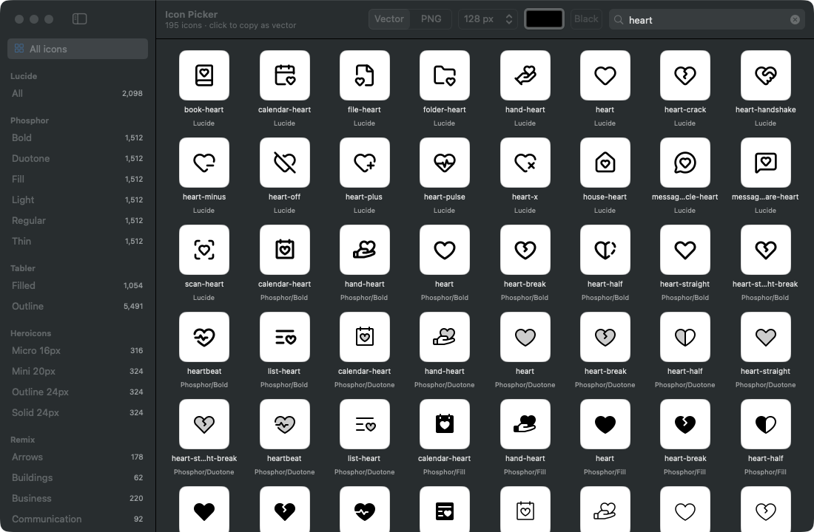

<p align="center">
  
</p>

<h1 align="center">Icon Picker</h1>

<p align="center">
  Search 29,000 free icons on your Mac. Click one, paste it anywhere — as real, editable vectors.
</p>

<p align="center">
  <a href="https://github.com/ahamedzoha/icon-picker/releases/latest/download/IconPicker.zip"><b>Download for macOS</b></a>
  &nbsp;·&nbsp; macOS 14 or later &nbsp;·&nbsp; Apple silicon and Intel &nbsp;·&nbsp; free and open source
</p>

<p align="center">
  
</p>

## Why

Icon websites copy an icon as SVG text or a flat picture. Paste that into a design app and you get
nothing, a block of code, or pixels. Icon Picker puts the icon on the clipboard the way design apps
expect: as vector shapes. Paste into Affinity and you get editable curves you can recolor, reshape and
scale.

## Features

- **One click to copy.** Click an icon, press ⌘V in any app.
- **Vector or PNG.** Vector for design and slide apps, PNG for chat apps, Notes, Mail and Docs.
- **Any size and color.** Pick 24–1024 px and a color before copying. Brand logos keep their own colors.
- **Drag and drop** icons straight into other apps or Finder.
- **Right-click** for Copy SVG Code, Copy File, and Show in Finder.
- **Fast search** across every set at once, or browse one set and weight at a time.
- **Free icon library built in.** One click downloads six popular open-source sets.
- **Your own icons too.** Point it at any folder of SVGs; subfolders become sets.
- **Automatic updates** through [Sparkle](https://sparkle-project.org).

## Install

1. [Download IconPicker.zip](https://github.com/ahamedzoha/icon-picker/releases/latest/download/IconPicker.zip)
   and unzip it.
2. Move **Icon Picker** to your Applications folder.
3. The app isn't notarized by Apple, so the first time, **right-click it and choose Open**, then
   click Open again. (Or run `xattr -dr com.apple.quarantine "/Applications/Icon Picker.app"`.)
4. Click **Download Icon Library…**. Icons are saved to `Documents/Vector Icons`, and macOS asks to
   let Icon Picker use your Documents folder. Because the app isn't signed with an Apple Developer
   ID, macOS may ask again after an update.

Already have SVGs? Use **File › Choose Icons Folder…** instead.

## Using it

| | |
|---|---|
| **Click** an icon | Copies it in the current mode, then paste with ⌘V |
| **Vector** mode | PDF + SVG on the clipboard, for design and slide apps (tested in Affinity) |
| **PNG** mode | A plain image: Messages, Slack, WhatsApp, Notes, Mail, Google Docs |
| **Size** | Size of the copied icon (vectors stay sharp at any size) |
| **Color** | Recolors the icon before copying. **Black** resets it |
| **Drag** an icon | Drops the `.svg` file into any app or Finder |
| **Right-click** | Copy as Vector / PNG, Copy SVG Code, Copy File, Show in Finder |
| **⌘O** | Choose a different icons folder |
| **⌘R** | Reload the folder after adding your own icons |

## The icon library

**File › Download Icon Library…** fetches the newest version of each set from the npm registry and
sorts it into folders. Run it again any time to update.

| Set | Icons | Styles | License |
|---|---|---|---|
| [Lucide](https://lucide.dev) | 2,098 | Outline | ISC |
| [Phosphor](https://phosphoricons.com) | 9,072 | Thin, Light, Regular, Bold, Fill, Duotone | MIT |
| [Tabler](https://tabler.io/icons) | 6,545 | Outline, Filled | MIT |
| [Heroicons](https://heroicons.com) | 1,288 | Outline, Solid, Mini, Micro | MIT |
| [Remix Icon](https://remixicon.com) | 3,229 | Line and fill, in 20 categories | Apache 2.0 |
| [Simple Icons](https://simpleicons.org) | 6,944 | 3,472 brand logos, black and brand color | CC0 |

Counts are from November 2026. Every set is free for personal and commercial use; each set's license
is saved in the `Licenses` folder next to the icons. Brand logos are trademarks of their owners — the
CC0 license covers the files, not the right to use a brand.

## How the vector copy works

Apps read the clipboard in their own order of preference, and that decides what you get:

- **Affinity** ignores SVG on the clipboard but turns a **PDF** into editable curves. If a PNG is on
  the clipboard too, it takes the PNG and you get pixels.
- So **Vector** mode puts a PDF (drawn from the SVG at your chosen size), the SVG itself
  (`public.svg-image`) and the SVG code as text — and deliberately **no PNG**.
- **PNG** mode puts only a PNG, which every app that accepts images understands.

Tested in Affinity 3.3: a pasted icon arrives as a group of curves, strokes intact.

## Build from source

Requires Xcode 16 or later.

```bash
git clone https://github.com/ahamedzoha/icon-picker.git
cd icon-picker
./scripts/build-app.sh
open "build/Icon Picker.app"
```

The app is a Swift package (SwiftUI, [Sparkle](https://github.com/sparkle-project/Sparkle) via SwiftPM).
`scripts/build-app.sh` builds a universal binary, assembles the `.app` bundle, embeds Sparkle and
signs it ad hoc.

## Releasing

Releases are built by GitHub Actions. Push a version tag:

```bash
git tag v1.1.0 && git push origin v1.1.0
```

The [Release workflow](.github/workflows/release.yml) builds the app, zips it, signs the zip with the
Sparkle EdDSA key from the `SPARKLE_PRIVATE_KEY` secret, writes `appcast.xml`, and publishes all of it
as a GitHub release. Installed copies find the update through the appcast at
`releases/latest/download/appcast.xml`. The build number is the commit count, so it always goes up.

Forking? Make your own key with Sparkle's `generate_keys`, put the public key in
`Resources/Info.plist` (`SUPublicEDKey`), update `SUFeedURL`, and save the private key
(`generate_keys -x key.txt`) as the `SPARKLE_PRIVATE_KEY` repository secret.

## License

Icon Picker is MIT licensed — see [LICENSE](LICENSE). The icons are not part of this repository; they
are downloaded from their projects and keep their own licenses.
